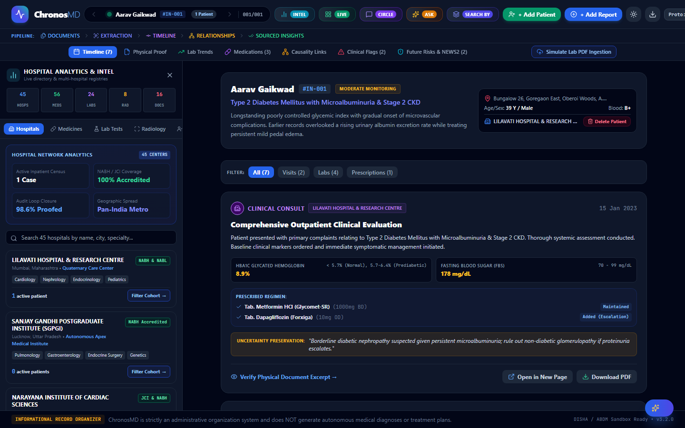

<div align="center">

# ChronosMD

### Longitudinal Health Provenance & Clinical Entity Reconciliation

**Turn scattered medical records into a verifiable health timeline, where every fact links back to its source.**

[](https://chronos-md.vercel.app)
[](./LICENSE)




</div>

---

## Overview

Patients collect reports from many hospitals, labs and doctors over the years, and the context between them gets lost. ChronosMD organises those records into a single **longitudinal timeline**. It tracks how results change, connects related documents, flags contradictions and gaps, and keeps every statement tied to the document it came from.

Built for **Code Heist 2026**, Healthcare & Smart Tech track, on the problem statement *"Patient Zero: The Missing Context"*.

> ChronosMD organises records only. It does **not** diagnose or recommend treatment.

## Features

- **Patient timeline:** visits, lab reports and prescriptions in date order, with filters
- **Lab trends:** repeated tests such as HbA1c and fasting blood sugar tracked over time
- **Medication history:** prescriptions across facilities, with changes marked (maintained, added, escalated)
- **Causality links:** connects related findings across different documents
- **Clinical flags:** spots contradictions, missing information and unresolved follow-ups
- **Uncertainty preservation:** keeps a doctor's hedged wording ("suspected", "rule out") instead of turning it into certainty
- **Physical proof viewer:** check the original document excerpt behind any fact
- **Hospital analytics:** a directory of hospitals, medicines, lab tests and radiology
- **Add patients and reports**, simulate lab PDF ingestion, and download reports as PDF
- **Light and dark themes**

## Dataset

The demo uses **100 synthetic Indian patient profiles** from 28 states and union territories, generated by [`generate_patients.py`](generate_patients.py) with a fixed seed. **No real patient data is included.**

## Tech stack

- HTML, CSS and vanilla JavaScript, with no build step
- Python 3 for generating the synthetic dataset
- Deployed on Vercel

## Getting started

```bash
git clone https://github.com/legend0x01/ChronosMD.git
cd ChronosMD
python -m http.server 8000   # then visit http://localhost:8000
```

To regenerate the patient dataset:

```bash
python generate_patients.py
```

## Project structure

```
index.html                      # Main application
report.html                     # Certified medical report view
patients-data.js                # Generated patient dataset
generate_patients.py            # Synthetic data generator
prd.txt                         # Product requirements document
PPT_CONTENT_CODEHEIST_2026.txt  # Presentation content
```

## License

Released under the [MIT License](LICENSE).
